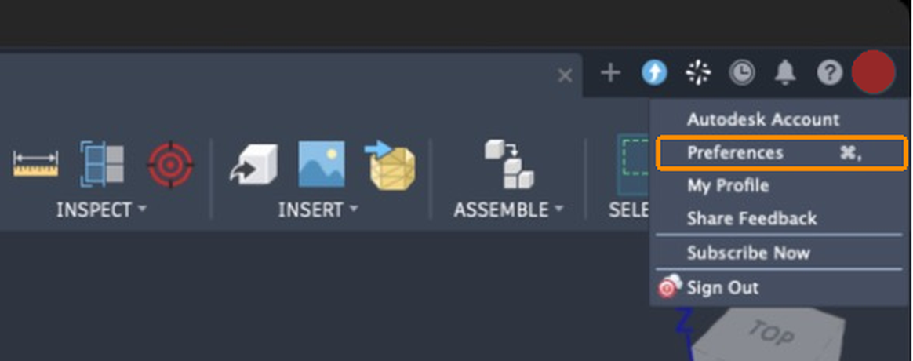
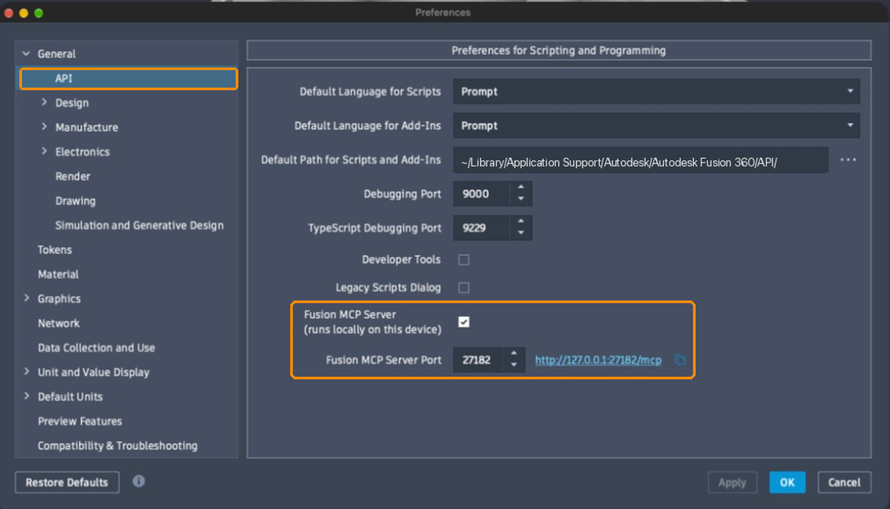

# How to install

## Install

In Claude Code:

```text
/plugin install fusion-bambulab --marketplace Avrmaster/fusion-bambulab
```

Or from a terminal:

```bash
claude plugin install fusion-bambulab --marketplace Avrmaster/fusion-bambulab
```

On Claude Code older than 2.1.292, add the marketplace first:

```text
/plugin marketplace add Avrmaster/fusion-bambulab
/plugin install fusion-bambulab@fusion-bambulab
```

Then run `/reload-plugins`, or restart Claude Code.

## Verify

```bash
claude plugin list
```

`fusion-bambulab` should show as enabled, and `/fusion-bambulab:setup-project` should autocomplete.

## Turn on Fusion's MCP server

Fusion has a built-in MCP server; the plugin talks to it. It is off by default.

**1.** In Fusion, click your profile picture at the top right, then **Preferences** (or press <kbd>⌘</kbd><kbd>,</kbd> on macOS).



**2.** Open **General > API**, tick **Fusion MCP Server**, and click **OK**. Leave the port at 27182 unless something else uses it.

 API page, with Fusion MCP Server ticked on port 27182">

**3.** Check that it answers. Fusion must be running:

```bash
curl -s -X POST http://127.0.0.1:27182/mcp -H 'Content-Type: application/json' -H 'Accept: application/json, text/event-stream' -d '{"jsonrpc":"2.0","id":1,"method":"initialize","params":{"protocolVersion":"2025-06-18","capabilities":{},"clientInfo":{"name":"check","version":"1"}}}'
```

A reply with `"serverInfo"` means it works. In a project set up by the plugin, `python3 fusion/tools/fusion_mcp.py ping` does the same.

**4.** In Claude Code, run `/mcp`: the plugin's `fusion` server should show as connected. Claude Code connects at session start, so if Fusion was started later, reconnect it there or open a new session. When Fusion is not running the server shows as failed, which is harmless.

If you changed the port, add a `.mcp.json` with that URL to the project.

## Update

```bash
claude plugin marketplace update fusion-bambulab
claude plugin update fusion-bambulab@fusion-bambulab
```

Auto-update is off by default for third-party marketplaces. Turn it on under `/plugin` > Marketplaces.

Existing projects keep their copy of the tools until you refresh them. Ask Claude to refresh them with `setup-project`, and review `git diff` afterwards.

## Uninstall

```bash
claude plugin uninstall fusion-bambulab
claude plugin marketplace remove fusion-bambulab
```

Your projects keep working: their tools are copied in. Printer templates stay in `~/.config/fusion-bambulab/`.

## Try a local copy

```bash
claude --plugin-dir /path/to/fusion-bambulab
```
