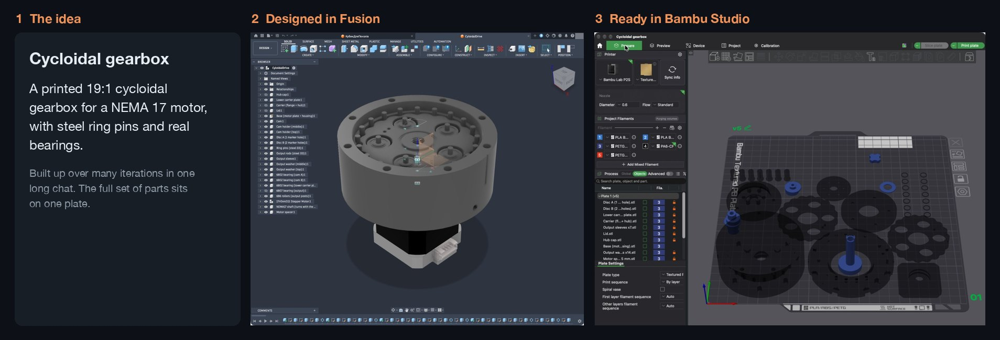
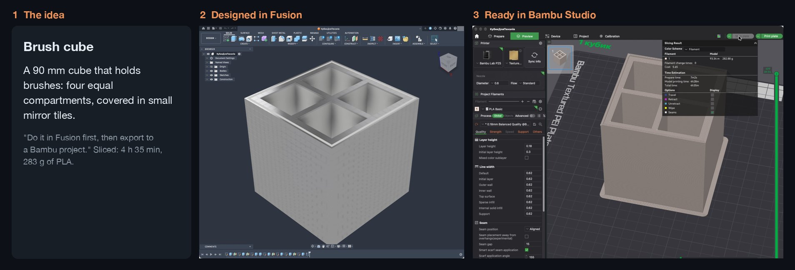
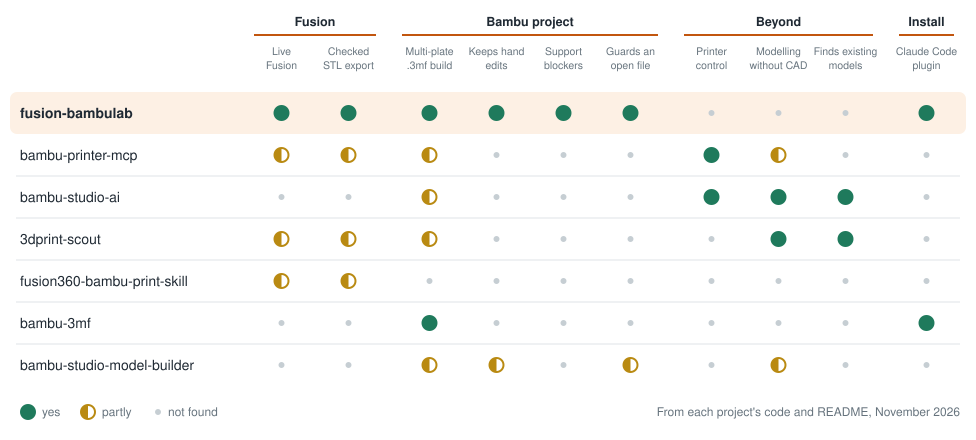

<p align="center">
  
</p>
<h1 align="center">fusion-bambulab</h1>
<p align="center">
  <strong>Claude Code designs in Autodesk Fusion and builds your Bambu Studio project.</strong>
</p>
<p align="center">
  <a href="https://github.com/Avrmaster/fusion-bambulab/actions/workflows/ci.yml"></a>
  <a href="LICENSE"></a>
</p>

## Install

**Claude Code:**

```text
/plugin install fusion-bambulab --marketplace Avrmaster/fusion-bambulab
```

**Another agent:**

```text
Install the fusion-bambulab skills from https://github.com/Avrmaster/fusion-bambulab, refer to the repo's AGENTS.md for instructions.
```

Update, uninstall and older versions: [INSTALL.md](INSTALL.md). Only Claude Code has been tested so far.

## What it does

Claude can drive Fusion and write `.3mf` files, but every new project starts from zero: it rediscovers the file format, hangs Fusion with a whole-model script, or produces a project Bambu Studio refuses to open. This plugin holds that knowledge once, so a new project starts from what the last one learned.

<table>
<tr>
<td width="50%">

### Before

> "Bambu says *Invalid configuration file*."
>
> "Fusion has been frozen for 20 minutes."
>
> "Why is there a solid slab over my screw holes?"
>
> "Copy the build script from my other project and change the printer again."

</td>
<td width="50%">

### After

> `/fusion-bambulab:setup-project Bracket`
>
> Then: *Design a wall bracket for a 25 mm pipe, export it, and make a Bambu project.*
>
> Parts are checked before export, every STL carries its Fusion version, and rebuilding keeps what you changed by hand in Bambu Studio.

</td>
</tr>
</table>

## Examples

Real projects, from idea to a plate ready to print. Both screenshots are straight from Fusion and Bambu Studio.

**A mechanical assembly:** bearings, steel pins, a motor and a full set of printed parts.



**A simple object:** one prompt, then a few rounds of changes.



## What's inside

The plugin connects Claude Code to Fusion's built-in MCP server, so every session has the Fusion tools once Fusion is running. No per-project setup.

| Skill | Does |
|---|---|
| `/fusion-bambulab:setup-project` | Sets a folder up: printer template, build script, design-rules file |
| `fusion-modeling` | Safe Fusion scripting, and the API traps that fail silently |
| `fusion-export` | Checked STL export, stamped with the Fusion version, plus stale-part and thin-feature checks |
| `bambu-project` | Builds and updates `.3mf` projects from code, keeping what you changed by hand |
| `print-design` | Orientation, tolerances, inserts, test prints, and what to do with a flawed print |

Claude picks the last four up on its own when the task calls for them.

## Requirements

- [Claude Code](https://code.claude.com) and Python 3
- Autodesk Fusion with **Preferences > General > API > Fusion MCP Server** on
- Bambu Studio, for the print side

The core tools use only the Python standard library. `numpy`, `scipy` and `shapely` add wall-thickness checks, bed packing and exact plate checks.

Developed and tested on macOS with a Bambu Lab P2S. Windows paths exist but have not been tested on real Fusion or Bambu Studio. Bed size comes from your printer's template, so other Bambu printers should work: [tell us how it goes](https://github.com/Avrmaster/fusion-bambulab/issues).

## A project looks like this

```text
my-project/
├── CLAUDE.md            points every session at this workflow
├── DESIGN_RULES.md      fits and decisions, tagged measured or not
├── fusion/parts.json    which Fusion bodies are printed parts
├── stl/                 checked exports
└── bambulab/
    ├── build_3mf.py     plates, orientation and settings, as code
    ├── template.3mf     your printer's presets
    └── Project.3mf      open this in Bambu Studio
```

Tools are copied into each project, so it keeps building without the plugin and an old project does not change under you.

## Good to know

- In sessions where Fusion is not running, the connector shows as failed in `/mcp`. That is harmless.
- Scripts drive your real Fusion document. Save before heavy work.
- Files are only rewritten with Bambu Studio closed; a wrapper closes and reopens it for you.
- A `.3mf` that slices in the CLI can still be refused by the GUI, so open a new project in the GUI once.
- The numbers in `print-design` come from one printer. Measure your own.

## Printing from Claude

This plugin stops at a ready Bambu Studio project: you open it, slice and print. To go further from Claude, add [bambu-printer-mcp](https://github.com/DMontgomery40/bambu-printer-mcp), which handles slicing, sending to the printer, AMS and monitoring. The two split the work:

```text
fusion-bambulab        Fusion design -> checked STL -> Bambu Studio project
bambu-printer-mcp   project -> sliced file -> printer
```

It is a separate project with its own licence (GPL-2.0), and it can start prints and heating without asking, so read its hardware safety notes first.

## How it compares

<picture>
  <source media="(prefers-color-scheme: dark)" srcset="docs/comparison-dark.svg">
  
</picture>

Each of these does something this plugin does not:

- **[bambu-printer-mcp](https://github.com/DMontgomery40/bambu-printer-mcp):** slicing, printing, AMS and monitoring over LAN
- **[bambu-studio-ai](https://github.com/heyixuan2/bambu-studio-ai):** idea to print in one flow, with model search and AI generation
- **[3dprint-scout](https://github.com/madrobotnet/3dprint-scout):** reference-first design with strict, evidence-based checks
- **[fusion360-bambu-print-skill](https://github.com/thibaud-sanchez/fusion360-bambu-print-skill):** print modes, and checking a saved project against expected parts
- **[bambu-3mf](https://github.com/woolimi/bambu-3mf):** projects built from system profiles, on many printer models
- **[bambu-studio-model-builder](https://github.com/DaveBitter/bambu-studio-model-builder):** quick single-object iteration with live reload in Claude Cowork

Several `.3mf` facts in `bambu-project` were confirmed by, or first learned from, these projects. See something wrong in the table? [Open an issue](https://github.com/Avrmaster/fusion-bambulab/issues) or edit `docs/comparison.py`.

## Contributing

New Fusion traps, `.3mf` rules and reports from other printers are the most useful contributions. See [CONTRIBUTING.md](CONTRIBUTING.md).

## License

[MIT](LICENSE). Not affiliated with or endorsed by Autodesk or Bambu Lab. Fusion and Bambu Lab are trademarks of their owners.
